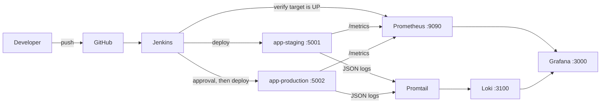

# System Health Dashboard

A small Flask API with a full continuous delivery and monitoring setup around it. Jenkins builds one Docker image, deploys it to **staging**, smoke tests it, checks it is visible in Prometheus, waits for a **human approval**, then deploys the same image to **production**. Prometheus, Loki, Promtail and Grafana show metrics, logs, a dashboard and alerts for both environments.

This repository covers two mini projects: Git-to-deployment workflow (Mini Project 1) and continuous delivery and monitoring (Mini Project 2).

## Architecture



## Repository structure

```
system-health-dashboard/
|-- app.py
|-- requirements.txt
|-- tests/test_app.py
|-- Dockerfile
|-- .dockerignore
|-- .gitignore
|-- Jenkinsfile
|-- docker-compose.staging.yml
|-- docker-compose.production.yml
|-- scripts/
|   |-- smoke_test.sh
|   `-- rollback.sh
|-- monitoring/
|   |-- docker-compose.monitoring.yml
|   |-- .env.example
|   |-- prometheus/        (prometheus.yml, alerts.yml)
|   |-- loki/              (loki-config.yml)
|   |-- promtail/          (promtail-config.yml)
|   `-- grafana/
|       |-- provisioning/  (datasources, dashboards)
|       `-- dashboards/    (system-health.json)
|-- REFLECTION.md
`-- README.md
```

## Endpoints

| Endpoint | Response |
|---|---|
| `/health` | `{"status": "UP"}` |
| `/version` | `{"version": "2.0.0"}` (from `APP_VERSION`) |
| `/environment` | `{"environment": "staging"}` (from `APP_ENV`) |
| `/metrics` | Prometheus metrics in text format |
| `/simulate-error` | Returns HTTP 500 only when `ENABLE_FAULT_INJECTION=true`, otherwise 404 |

### Metrics

| Metric | Type | Labels |
|---|---|---|
| `http_requests_total` | Counter | `method`, `endpoint`, `status` |
| `http_request_duration_seconds` | Histogram | `endpoint` |
| `app_info` | Gauge (always 1) | `version`, `environment` |

### Logs

Every request writes one JSON line to stdout with the fields `timestamp`, `level`, `message`, `endpoint`, `method`, `status` and `environment`. Responses with status 500 or above are logged at level `ERROR`, all others at `INFO`.

## Configuration

| Variable | Purpose | Default |
|---|---|---|
| `APP_ENV` | Environment name shown by `/environment`, `app_info` and the logs | `unknown` |
| `APP_VERSION` | Version shown by `/version` and `app_info` | `2.0.0` |
| `ENABLE_FAULT_INJECTION` | Enables `/simulate-error` when set to `true` | `false` |
| `GRAFANA_ADMIN_USER` | Grafana login (in `monitoring/.env`) | `admin` |
| `GRAFANA_ADMIN_PASSWORD` | Grafana password (in `monitoring/.env`, required) | none |

`APP_ENV` keeps the name used in Mini Project 1. Nothing is hard-coded: environments are selected by variables at run time, and no secrets are committed.

## Prerequisites

- Git
- Python 3.9 or later with `venv`
- Docker with the Compose plugin
- A Jenkins server with Git, Pipeline and JUnit plugins, the Docker CLI with the Compose plugin, Python 3 with `venv`, `curl`, and access to the Docker socket

## One-off setup

Create the shared Docker network, and connect Jenkins to it so the pipeline can reach the apps and Prometheus by name:

```bash
docker network create shd-monitoring
docker network connect shd-monitoring jenkins
```

Re-run the `connect` command if the Jenkins container is ever recreated.

## Run locally

```bash
git clone https://github.com/m23451/system-health-dashboard.git
cd system-health-dashboard
python3 -m venv .venv
source .venv/bin/activate
pip install -r requirements.txt
APP_ENV=dev python app.py
```

Verify from a second terminal:

```bash
curl http://localhost:5000/health
curl http://localhost:5000/version
curl http://localhost:5000/environment     # {"environment":"dev"}
curl http://localhost:5000/metrics
```

## Run the tests

```bash
python -m pytest -v
```

There are six tests: the three original endpoint tests, plus tests for `/metrics` and for the fault-injection switch being off and on.

## Build and run one container

```bash
docker build -t system-health-dashboard:local .
docker run -d --name shd -p 5000:5000 -e APP_ENV=docker system-health-dashboard:local
curl http://localhost:5000/environment     # {"environment":"docker"}
docker rm -f shd
```

## Start the monitoring stack

```bash
cp monitoring/.env.example monitoring/.env
# edit monitoring/.env and set GRAFANA_ADMIN_PASSWORD
docker compose -p shd-monitoring -f monitoring/docker-compose.monitoring.yml --env-file monitoring/.env up -d
```

`monitoring/.env` is ignored by Git and must never be committed.

| Service | URL |
|---|---|
| Grafana | http://localhost:3000 (login from `monitoring/.env`) |
| Prometheus | http://localhost:9090 |
| Loki | http://localhost:3100 |

Grafana data sources and the **System Health Overview** dashboard are provisioned from the files in `monitoring/grafana/`, so no manual setup is needed.

## Start the environments manually

Jenkins does this automatically. To do it by hand:

```bash
IMAGE_TAG=local docker compose -p shd-staging -f docker-compose.staging.yml up -d
IMAGE_TAG=local docker compose -p shd-production -f docker-compose.production.yml up -d
```

| Environment | URL | Container |
|---|---|---|
| Staging | http://localhost:5001 | `app-staging` |
| Production | http://localhost:5002 | `app-production` |

## Jenkins pipeline

Create a Pipeline job with *Pipeline script from SCM*, this repository's URL, branch `*/main` and script path `Jenkinsfile`.

| Stage | What it does |
|---|---|
| Checkout | Clones the repository and records the branch |
| Install | Creates a virtual environment and installs dependencies |
| Test | Runs pytest and publishes JUnit results; a failure stops the pipeline |
| Build and tag | Builds the image and tags it with the Jenkins build number |
| Deploy to Staging | Records the previous staging tag, then starts the new image with Compose |
| Smoke test (staging) | Calls `/health`, `/version` and `/metrics` on `app-staging` |
| Verify monitoring | Queries the Prometheus API until the staging target is `up` |
| Approval gate | `main` only. Pauses until a person clicks Approve |
| Deploy to Production | `main` only. Deploys the same image tag, with no rebuild |
| Smoke test (production) | `main` only. Same checks against `app-production` |

Staging is deployed from any branch the job builds. The approval gate and production stages run only when the branch is `main`.

### Approving a release

When a `main` build reaches the Approval gate it stays paused. Open the build page (or `http://localhost:8080/job/system-health-dashboard/<build number>/input/`) and click **Approve**. The console then prints `Approved by: <name>`.

### Rollback

Before each deploy, the pipeline reads the image tag currently running. If the smoke test (or another stage after the deploy) fails, `scripts/rollback.sh` redeploys that previous tag to the environment that failed, and the build is marked failed. Check the running tag with:

```bash
docker inspect --format '{{.Config.Image}}' app-staging app-production
```

## Verify the monitoring

1. Prometheus targets: http://localhost:9090/targets shows both targets **UP**.
2. Generate traffic:
   ```bash
   for i in $(seq 1 60); do curl -s -o /dev/null localhost:5001/health; curl -s -o /dev/null localhost:5002/version; sleep 1; done
   ```
3. In Grafana, open **System Health Overview**, set the time range to the last 15 minutes, and use the **Environment** dropdown to switch between staging and production.
4. Logs: in Grafana Explore, choose Loki and run `{environment="staging"} | json` to see request logs.

### Dashboard panels

Service status, Application info, Request rate, Error rate %, Latency p95, Application logs and Error logs.

### Alerts

| Alert | Condition | Severity |
|---|---|---|
| `ServiceDown` | `up == 0` for 1 minute | critical |
| `HighErrorRate` | 5xx responses above 5% of requests (2-minute rate), pending for 1 minute | warning |

Alert state is shown at http://localhost:9090/alerts. No notification channel is configured.

## Git workflow

`main` holds released code and `develop` is the integration branch. Work was done on feature branches (`feature/api-endpoints`, `feature/tests`, `feature/docker`, `feature/jenkins`, `feature/metrics`, `feature/monitoring-stack`, `feature/cd-pipeline`, `feature/documentation`) and merged into `develop` with `--no-ff`. `develop` reaches `main` through pull requests. Releases are tagged (`v1.1.0`, `v2.0.0`).

**Merge conflict (Mini Project 1):** `feature/tests` and `feature/docker` both changed the `VERSION` line in `app.py`, so Git could not merge them automatically. I kept the environment-variable version with a default value, ran the tests to confirm nothing broke, and committed the resolution.

## Continuous Delivery or Continuous Deployment?

This pipeline is **Continuous Delivery**. Every build that passes the tests is deployed to staging automatically and is always ready to release, but a person must approve the production deployment. It would become Continuous Deployment if the Approval gate stage were removed, so that every build passing staging went straight to production.

## Known limitations and improvements

- The incident drill (injecting a fault on staging, detecting it, diagnosing it from logs and recovering) was not carried out. The fault switch, error-rate panel, error-log panel and `HighErrorRate` alert are built and loaded, but the alert has not been observed firing.
- The image is built and kept on the local Docker host, with no registry push.
- The app runs on Flask's development server as root, and production use would need gunicorn and a non-root user.
- Jenkins runs as root with the Docker socket mounted, which is acceptable for a lab but not for production.
- Builds are started manually, and a webhook would trigger them on push.
- Alerts have no notification channel such as Alertmanager.
- Branch protection on `main` would enforce pull requests and reviews.

## AI assistance

I used Claude (Anthropic) as a guide throughout both projects: planning the work, example code for the app, tests, Dockerfile, Compose files, monitoring configuration and Jenkinsfile, explaining the Git workflow, and troubleshooting errors. I ran every command, build and pipeline myself, adapted the code, and I tested and can explain every submitted file.
